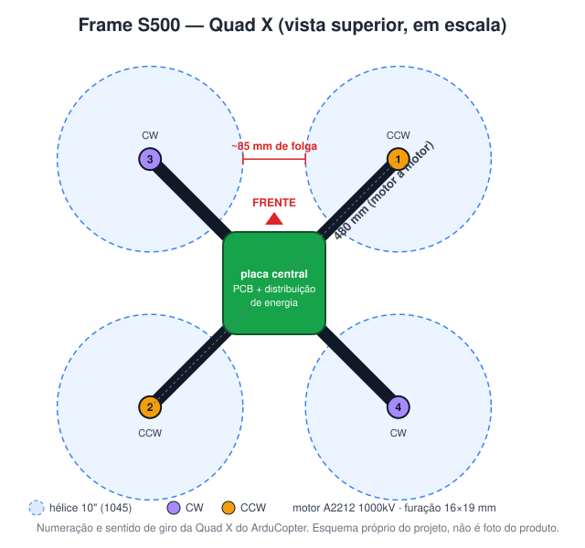
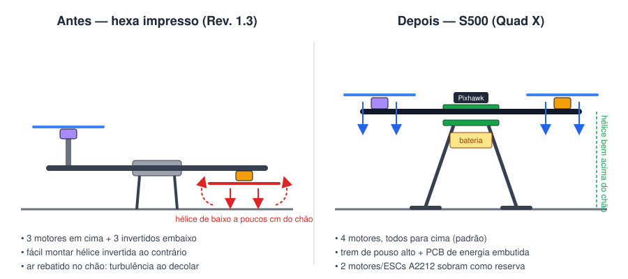
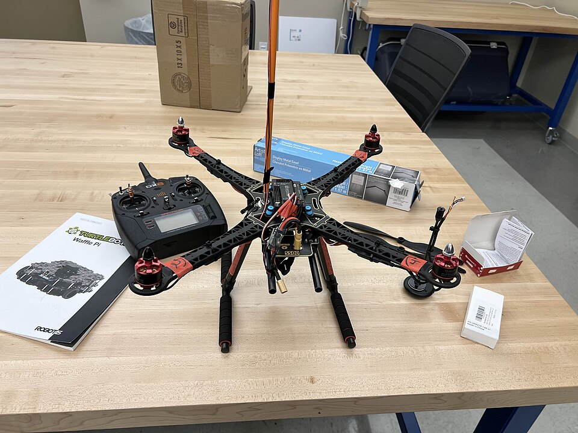
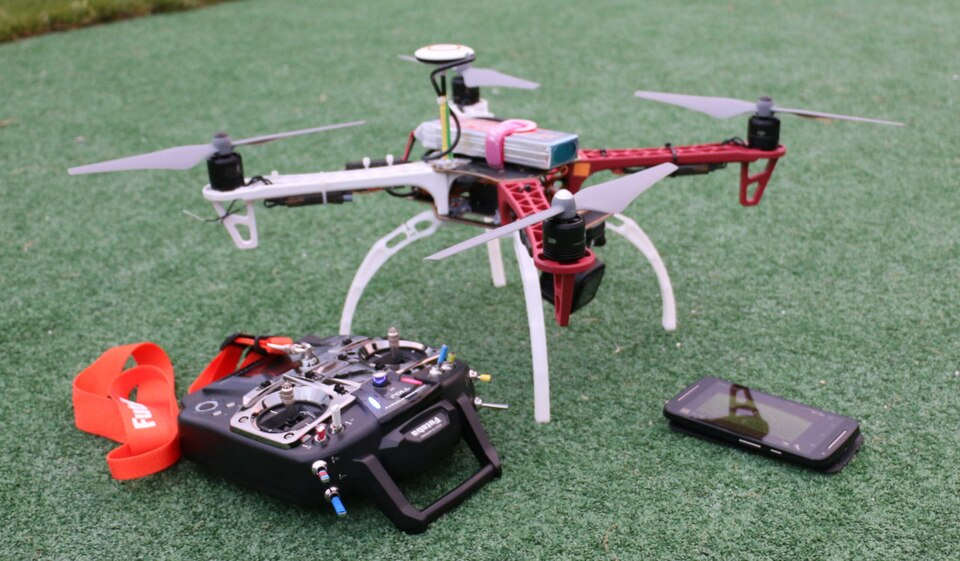
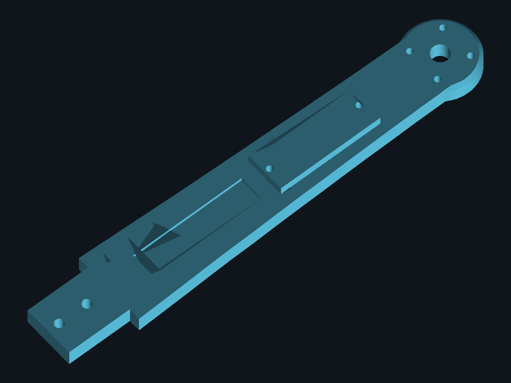
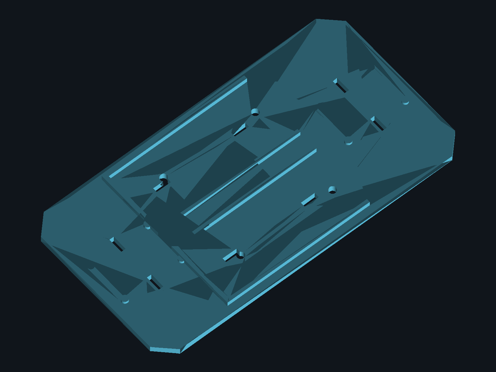
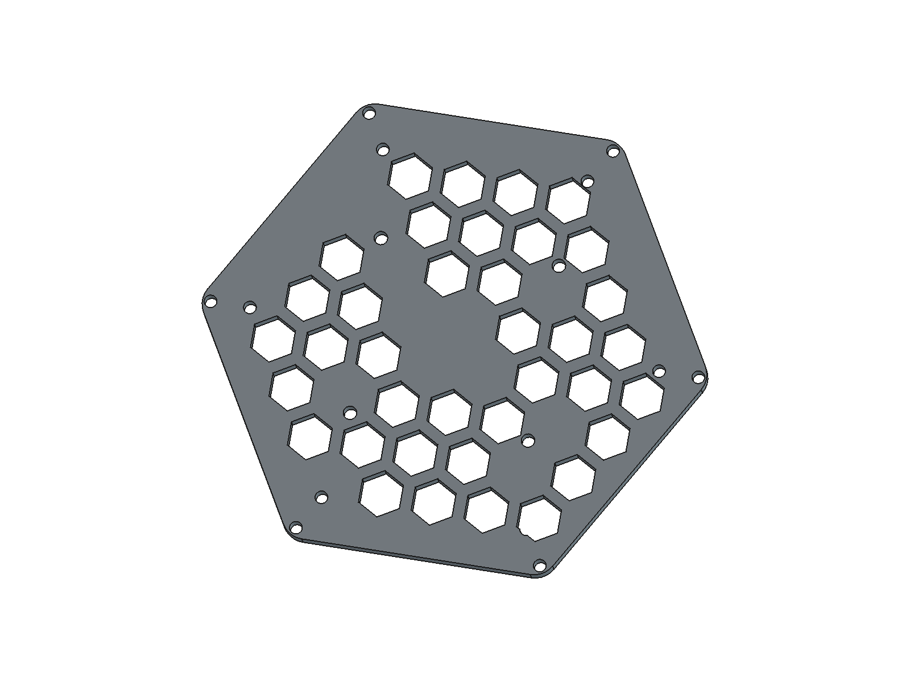

<div align="center">

# SkyVolt

**Drone medidor e fiscalizador de ambientes de alta e baixa energia**



</div>

Quadricóptero montado sobre o frame comercial **S500** (Quad X, Pixhawk + ArduCopter) cuja função principal é medir tensão e corrente elétrica em pontos de um ambiente controlado, classificar automaticamente o tipo de circuito (AC/DC, faixa de tensão) e reportar os dados a um aplicativo desktop de controle e monitoramento em tempo real via LoRa.

Projeto da disciplina 34943 — Desenvolvimento de Aplicações Computacionais (tema-base: Monitor de Consumo e Qualidade de Energia / Smart Grid), usando o SkyVolt como o protótipo físico opcional permitido pelo enunciado. Documento completo de requisitos, arquitetura e BOM em [`docs/SkyVolt_Documento.pdf`](docs/SkyVolt_Documento.pdf); Roadmap do semestre (14/08 a 02/12/2026) em [`ideias/roadmap.md`](ideias/roadmap.md); devolutivas das entregas em [`avaliacoes/`](avaliacoes/).

## Equipe

<!-- preencher com nome + usuário GitHub de cada integrante antes da entrega A1/1 — é critério de nota (governança/git) -->
- Matheus Dapper ([@aCoruja](https://github.com/aCoruja))
- _Vitória Aparecida Vendausen([@Viihvendausen](https://github.com/Viihvendausen)_

- _Sophia Gama de Moura ([@Sophthe141](https://github.com/Sophthe141))_

## Estrutura do repositório

```
README.md       este arquivo — visão geral, equipe e estado do projeto
docs/           documentos técnicos: requisitos, arquitetura e BOM (fonte .tex + PDF gerado),
                requisitos funcionais do app desktop
ideias/         planejamento e acompanhamento de ideias — o que o time PLANEJA fazer, semana a semana
avaliacoes/     devolutivas oficiais do professor por entrega — nota, feedback, pontos a corrigir
hardware/       projeto mecânico (CAD paramétrico FreeCAD, STL/STEP para impressão 3D)
  frame/        hexa impresso Rev. 1.3 (hub, braço x6, bandeja) — substituído pelo S500, ver abaixo
  legacy/       versão anterior do frame (peça única), mantida como referência
  previews/     renders das peças, esquemas do S500 e fotos de referência (fotos/, com créditos)
firmware/       código dos dois ESP32 (voo/FPV e telemetria/LoRa) — a especificar
app/            aplicativo desktop de controle e monitoramento — a especificar
notebooks/      prototipagem e análise de dados (calibração de sensores, protocolo LoRa, etc.)
```

`ideias/` e `avaliacoes/` são complementares: um documenta o planejamento, o outro o resultado real de cada entrega — mantidos junto ao roadmap para não perder o histórico de evolução da nota ao longo do semestre.

## Frame: troca para o S500

O frame do protótipo passou a ser o **S500** (kit comercial de 500mm, com trem de pouso e placa central de distribuição de energia), montado como **Quad X** com 4 dos motores A2212 1000kV que já tínhamos. O hexa impresso em 3D (Rev. 1.3) foi abandonado após os primeiros testes de voo, em outubro de 2026.

<div align="center">

</div>

### Por que trocamos

O hexa impresso tinha 6 braços com alturas alternadas: 3 motores em cima (riser de 40mm) e 3 **invertidos embaixo do braço**. Nos testes com a Pixhawk ele **não saiu do chão**:

- **Com ~82% de acelerador não decolou.** A bateria caiu de 12,44V para 9,73V: os motores puxavam muita corrente e geravam pouco empuxo. A suspeita principal são as **hélices dos motores invertidos montadas ao contrário**, soprando para cima e anulando as de cima. É um erro fácil de cometer em motor de cabeça para baixo.
- **Hélices de baixo a poucos centímetros do chão.** O ar batia no chão e voltava como redemoinho, causando turbulência e o aviso *"EKF attitude is bad"* na tentativa de decolagem.
- **Configuração frágil.** O layout fora do padrão exigiu orientação customizada da Pixhawk (yaw 180° + pitch 10° para compensar a placa inclinada), mapeamento manual saída → motor e uma correção de Y6 para Hexa +. Cada ajuste era uma nova chance de erro.

<div align="center">
<table>
<tr>
<td align="center" width="50%">
<br>
<b>S500</b> — a alternativa considerada: braços longos e trem de pouso alto<br>
<sub>Foto: <a href="https://commons.wikimedia.org/wiki/File:Holybro_S500_Edition_2015_(FA3KAETHRC)_(1-23-2025).jpg">ZLEA</a>, CC BY-SA 4.0</sub>
</td>
<td align="center" width="50%">
<br>
<b>F450</b> — o frame escolhido: menor (450mm) e trem de pouso relativamente baixo<br>
<sub>Foto: <a href="https://commons.wikimedia.org/wiki/File:F450-DJI-Futaba.JPG">Alexey M.</a>, CC BY-SA 4.0</sub>
</td>
</tr>
</table>
</div>

O S500 resolve isso por ser o formato padrão:

- **Todos os motores para cima.** Não há hélice invertida nem ar rebatido no chão, e o **trem de pouso alto** deixa as hélices longe do solo e abre espaço para a bateria embaixo.
- **Dimensionado para hélice de 10".** Os motores ficam a ~480mm na diagonal, com **~85mm de folga** entre hélices vizinhas (no F450, a alternativa mais barata, seriam ~64mm: também voa, mas com menos margem).
- **Compatível com o que já temos.** O anúncio recomenda motor 2212 ~1000kV, hélice 1045/1047 e bateria 3S–4S, exatamente o nosso conjunto. A furação 16×19mm dos braços serve no A2212.
- **Configuração simples no ArduCopter.** Quad X tem os melhores parâmetros de fábrica, e a Pixhawk vai reta sobre amortecedores, sem rotação customizada.
- **Peças de reserva.** Dos 6 motores e ESCs A2212, sobram 2 de cada.
- **Barato e fácil de achar** no Brasil (~R$ 100–250 o kit só com a estrutura).

**Hélices:** as que temos são 9×4,75 ("9045"). Com 4 motores, a relação empuxo/peso ficaria em ~1,8:1 (4 × ~620g para ~1,3–1,4kg), abaixo do ideal de 2:1. Por isso o plano é usar **hélices 1045** no S500, chegando a ~2,3:1 (4 × ~800g). As 9" ficam de reserva.

## Estado atual

- Requisitos, arquitetura e BOM fechados (Rev. 1.3 do documento; BOM e frame ainda a atualizar para o S500).
- **Frame:** S500 Quad X com 4× A2212 1000kV e hélices 1045. Pendentes: montagem, soldagem dos ESCs na placa central, configuração Quad X e recalibração (acelerômetro, nível, bússola) e adaptação da bandeja de eletrônica (ESP32 + LoRa) e dos efetuadores ao S500.
- Aplicativo desktop em desenvolvimento em [`app/`](app/); firmware dos ESP32 ainda não iniciado. Ver Seção 8 (Pendências) do documento.

## Frame anterior — hexa impresso (Rev. 1.3, histórico)

Mantido como referência do design que foi substituído pelo S500. Gerado pelo script paramétrico [`skyvolt_frame.py`](hardware/frame/skyvolt_frame.py) (FreeCAD). Arquivos `.stl`/`.step`/`.FCStd` em [`hardware/frame/`](hardware/frame/).

<div align="center">
<table>
<tr>
<td align="center" width="33%">
<br>
<b>Hub</b> — 1× — 129,6×121,2mm
</td>
<td align="center" width="33%">
<br>
<b>Braço</b> — 6× — 154×26mm
</td>
<td align="center" width="33%">
<br>
<b>Bandeja de eletrônica</b> — 1× — 150×80mm
</td>
</tr>
</table>
</div>

Todas as peças cabem numa mesa de impressão de 220×220mm. Hub e braço se unem por encaixe lingueta/rasgo + 2 parafusos M3 por junta; motor A2212 1000kV (furação 16×19mm/4×M3); braço já sai com base de fixação para servo SG90.

### Peça nova (em revisão)

Ainda pendente de validação de fit e dimensões finais — ver [`hardware/frame/README.md`](hardware/frame/README.md).

<div align="center">
<br>
<b>Tampa do hub (Hub Lid)</b> — 1×
</div>

> `SkyVolt_Frame.*` também foi gerado, mas o bounding box real (330×290,3mm) bate com o frame legado de peça única — não cabe na mesa de 220×220mm. Movido para [`hardware/legacy/`](hardware/legacy/) em vez de entrar na lista de peças a imprimir.

## Utilização de IA

A utilização de IA foi realizada de forma educativa e colaborativa, com fins de estudo. A ferramenta não foi utilizada para resolver os problemas sem a aplicação de raciocínio lógico e compreensão por parte dos autores.
