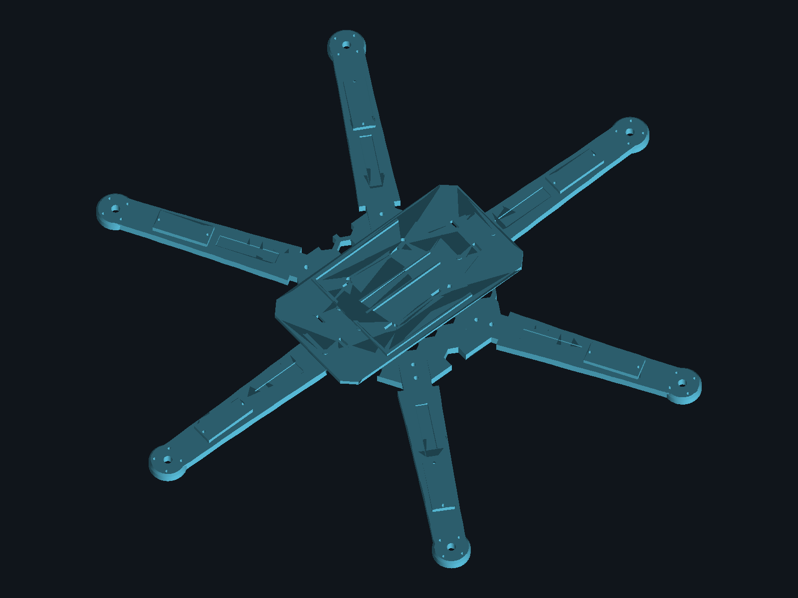

# Frame — peças atuais (Rev. 1.3)

3 peças impressas separadamente, todas dentro da mesa de impressão de 220×220mm:

| Peça | Arquivo | Qtd | Dimensões |
|---|---|---|---|
| Hub | `SkyVolt_Hub.stl` | 1 | 129,6×121,2mm |
| Braço | `SkyVolt_Arm.stl` | 6 | 159×34mm |
| Bandeja de eletrônica | `SkyVolt_Tray.stl` | 1 | 150×80mm |

Gerado pelo script paramétrico `skyvolt_frame.py` (FreeCAD, `freecad.cmd skyvolt_frame.py`). `SkyVolt_Assembly_Preview.*` é só visualização (hub + 6 braços + bandeja posicionados), não é peça de impressão.

## Peça nova (em revisão)

| Peça | Arquivo | Script |
|---|---|---|
| Tampa do hub (Hub Lid) | `SkyVolt_HubLid.stl` | `skyvolt_hub_lid.py` |

`SkyVolt_ClampAssembly_preview.png` / `SkyVolt_ClampAssembly_check.svg` (em `../previews/`) são renders de verificação do encaixe da tampa nas linguetas do braço/hub, gerados junto com a Hub Lid.

Fit, encaixe com as peças existentes e dimensões finais ainda não confirmados — pendente de validação antes de imprimir.

Havia também um `SkyVolt_Frame.*` aqui, mas o bounding box real (330×290,3mm) confirmou que é o mesmo tamanho do frame legado de peça única — não cabe na mesa de 220×220mm. Movido para [`hardware/legacy/`](../legacy/).

Hub e braço se unem por encaixe lingueta/rasgo + 2 parafusos M3 por junta. Motor: **A2212 1000kV** (confirmado — can 27,5×27mm, eixo 3,17mm, furação 16×19mm/4×M3, medido no motor real). Pad de fixação do motor aumentado para 17mm de raio pra cobrir esse padrão com folga de parede — `SkyVolt_Arm.stl`/`.step` já regerados e conferidos (furos exatos em 190±8/±9,5mm, raio 1,6mm; disco até x=207mm; bounding box atualizado na tabela acima). Braço já sai com base de fixação para servo SG90 (M2, 32,5mm de espaçamento). Bandeja carrega 2×ESP32-S3 (trilho dimensionado para o footprint oficial 70×28mm) e 2×módulo LoRa (baia genérica por abraçadeira, footprint do módulo ainda não confirmado).
