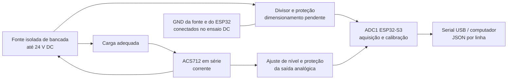

# SCRUM-14 — medidor em bancada

**Estado: planejamento e esqueleto de firmware; montagem, aquisição real, calibração e testes de bancada ainda pendentes.** A descrição do card foi fornecida pela equipe. O protótipo deve ser revisado antes de montar e ensaiado somente com fontes isoladas de baixa tensão, até 24 V nesta etapa. Protoboard e módulos desconhecidos não autorizam teste de rede. Ensaios posteriores com tensões perigosas dependem do circuito definitivo, da verificação dos componentes e da supervisão do professor; não pressupor que o módulo ZMPT disponível seja seguro só por ter um transformador.

## Relação com RNF02

O divisor DC diretamente no ADC conecta o negativo medido ao GND do ESP32. É uma topologia de bancada para fonte isolada, não a solução de isolamento do drone. A arquitetura provisória do RNF02 coloca condicionamento e aquisição no domínio medido e usa alimentação e dados isolados; ver [decisão e plano de isolamento](README.md). Os módulos ZMPT101B e ACS712 disponíveis podem servir a ensaios independentes, mas não demonstram uma solução única de AC/DC nem a conformidade de toda a montagem. O ADS1115 por si só também não isola.

## Diagrama funcional — somente bancada isolada

O diagrama não é um esquemático elétrico: faltam pinos, componentes de proteção e valores aprovados. Não montar com base nele. Para AC, usar fonte de baixa tensão isolada apropriada e entrada condicionada para ambos semiciclos; confirmar isolamento de fonte, instrumentos e demais conexões. O canal DC e qualquer canal AC requerem análise de caminhos de terra antes de serem ligados simultaneamente.

Uma seleção provisória de modelos genéricos e um esboço de ligações para revisão estão em [componentes de referência](componentes-referencia.md).

## Pontos para o projeto

- Identificar o modelo da placa ESP32-S3, sensores e instrumentos, inclusive variante do ACS712 e saída do SCT-013. Determinar faixa de tensão, corrente, frequência e carga, limitações do multímetro e fonte; obter o esquema elétrico revisado **antes da montagem**.
- A sugestão 390 kΩ/10 kΩ produz nominalmente 2,5 V para 100 V, porém não isola e não dimensiona proteção, potência, tolerâncias, tensão por resistor, falhas ou transientes. Ela não habilita testar 100 V em protoboard. O capacitor e a impedância do divisor afetam resposta e precisão.
- O ACS712 possui saída dependente de alimentação, offset e sensibilidade da variante. Ajustar a saída de 5 V para os limites do ADC, inclusive em falhas e energização; medir o zero somente com corrente comprovadamente nula. A isolação do CI não garante a isolação do módulo ou da montagem.
- Preferir ADC1 e verificar pinos e calibração na placa e versão do framework. Calibração do ADC não substitui calibração do conjunto. O ADS1115 multiplexado não alcança a sugestão de 2 kHz de amostragem: seu limite total é 860 amostras/s; avaliar taxa por canal e efeito do atraso para potência.
- Em AC, sincronizar ou medir o intervalo entre amostras de tensão e corrente e compensar atrasos de canais e sensores antes de calcular potência ativa. 2 kHz por canal durante 10 ciclos a 60 Hz implica cerca de 333,3 amostras por canal, não um número inteiro exato. Definir janela e medição de frequência, sem presumir rede perfeitamente estável.
- Classificação requer limiares validados, histerese e estado indeterminado para ruído, ausência de sinal, saturação e formas de onda fora da faixa. Contar cruzamentos não distingue universalmente AC de DC com ondulação. Não usar a classificação como proteção contra sobretensão.
- Definir quando medições e coeficientes são válidos, como detectar saturação e como versionar calibração; não calibrar zero de corrente sob carga. Potência ativa AC precisa de referência adequada e teste com carga não puramente resistiva para validar defasagem, além do primeiro teste resistivo.

## Roteiro de validação e registro

Metas **sugeridas**, sujeitas a aprovação da equipe e professor: tensão DC até 2% de erro, tensão AC e corrente até 5%, classificação correta nos cenários acordados. Erro percentual é `100 × |medido − referência| / |referência|`; em zero usar erro absoluto e definir tolerância específica. Definir faixa mínima e incerteza dos instrumentos antes de aceitar a meta; dividir calibração e validação em pontos distintos.

| Cenário | Referência | Leitura | Erro | Classificação esperada / observada | Resultado |
|---|---:|---:|---:|---|---|
| DC, zero e múltiplos pontos até 24 V | Pendente | Pendente | Pendente | DC ou indeterminado em zero / pendente | Não ensaiado |
| DC, múltiplas correntes e polaridades previstas | Pendente | Pendente | Pendente | DC / pendente | Não ensaiado |
| AC isolada de baixa tensão e carga resistiva | Pendente | Pendente | Pendente | AC / pendente | Não ensaiado |
| Sem sinal, ruído, saturação e contato ausente | Pendente | Pendente | Pendente | Conforme critério validado / pendente | Não ensaiado |
| Potência ativa com defasagem conhecida | Pendente | Pendente | Pendente | AC / pendente | Não ensaiado |

Registrar data, responsáveis, esquema/revisão, placa, sensores, fonte e limite de corrente, instrumentos e suas incertezas, firmware, coeficientes, valores de referência, fotos e anomalias. Testes acima de 24 V, incluindo 48 V e 220 V citados no card, não fazem parte desta etapa. [Protocolo de saída proposto](../../docs/protocolo_telemetria.md).

Referências: [Espressif — ADC ESP32-S3 e compartilhamento do ADC2](https://docs.espressif.com/projects/esp-idf/en/latest/esp32s3/api-reference/peripherals/adc/adc_oneshot.html); [TI — ADS1115](https://www.ti.com/lit/ds/symlink/ads1115.pdf); [Allegro — ACS712](https://www.allegromicro.com/-/media/files/datasheets/acs712-datasheet.ashx).
